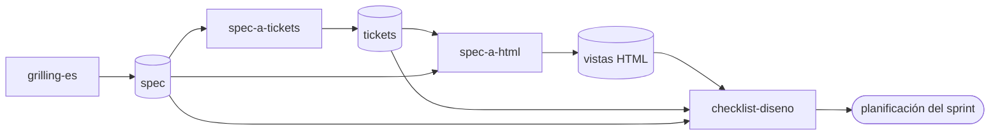
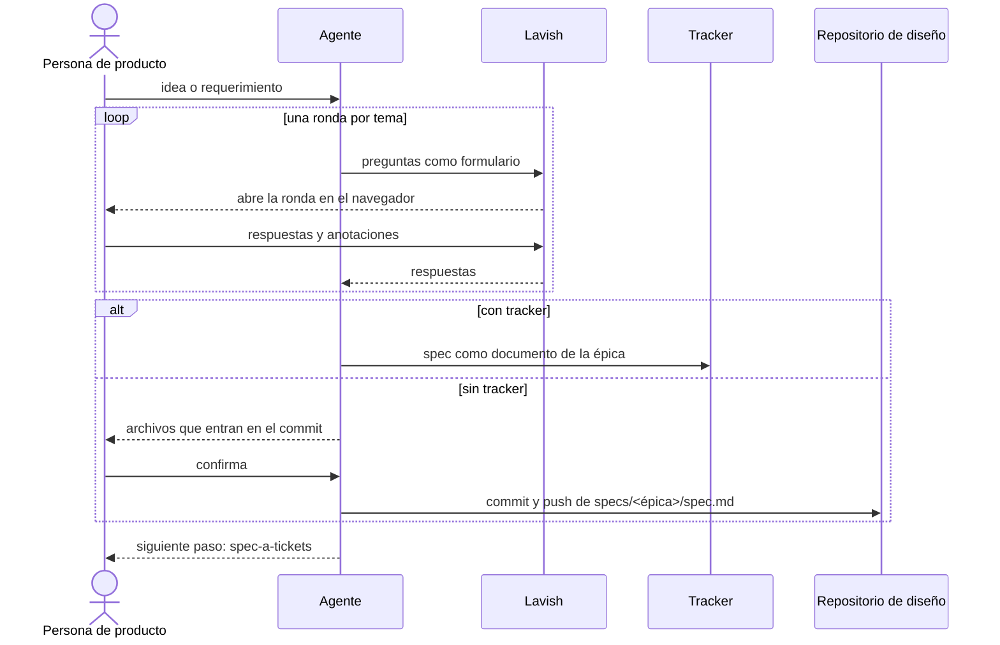

# design-flow-skills

Skills en español para pasar de una idea de producto a un diseño listo para construir: grilling del requerimiento, spec con historias de usuario, tickets y HTML de cada vista sobre un design system liviano. Funcionan con Claude Code y con cualquier agente compatible con `npx skills`.

---

## Flujo

1. `grilling-es`: entrevista al requerimiento antes de dibujar. Usa Lavish cuando la sesión tiene terminal y el chat cuando no. Cierra con el spec sobre una plantilla fija.
2. `spec-a-tickets`: escribe los tickets desde el spec, antes del HTML, con historia, criterios de aceptación "Dado, cuando, entonces", pruebas, casos borde y preguntas abiertas. Los publica en el tracker del proyecto o, si no hay, como un archivo markdown por ticket.
3. `spec-a-html`: en una sesión nueva, toma el spec y genera el HTML de la vista o del flujo. Busca un design system existente y, si no hay, lo crea, siempre preguntando antes.
4. `checklist-diseno`: revisa el HTML contra la definición de listo antes de la planificación del sprint.

El nombre con que se invoca cada skill depende de cómo se instaló. Al cerrar, cada skill nombra el siguiente paso con las dos formas y dice qué hace.

| Con `npx skills` | Con el plugin de Claude Code |
| :--- | :--- |
| `grilling-es` | `flujo-diseno:grilling-es` |
| `spec-a-tickets` | `flujo-diseno:spec-a-tickets` |
| `spec-a-html` | `flujo-diseno:spec-a-html` |
| `checklist-diseno` | `flujo-diseno:checklist-diseno` |

---

## Uso

Cada skill deja un artefacto que toma la siguiente:



Una sesión de `grilling-es`, con Lavish cuando hay terminal:



---

## Artefactos

Todo vive en un repositorio de diseño por producto, separado del repositorio de código:

```
design/
  tokens.css        design system: variables CSS (color, tipografía, espaciado, radios, sombras, temas)
  components.css    componentes compartidos, construidos sobre tokens.css
  vistas/           un HTML semántico por vista o flujo
specs/
  <épica>/
    spec.md
    tickets/NN-titulo.md   solo si el proyecto no tiene tracker
```

El formato es liviano a propósito: los agentes leen estos archivos en cada tarea. Un HTML enlaza `tokens.css` y `components.css`, no usa frameworks por CDN, y muestra sus estados con `?escenario=` o un panel `data-proto`, nunca con controles dentro de la pantalla.

---

## Instalación

Con Claude Code, el camino principal es el plugin. Desde una sesión:

```
/plugin marketplace add grez-lucas/design-flow-skills
/plugin install flujo-diseno@design-flow-skills
```

El plugin queda instalado a nivel de usuario y no escribe archivos en el repositorio de diseño.

Con otro agente, la alternativa es `npx skills` (Node.js 22.20 o superior):

```
npx skills add grez-lucas/design-flow-skills -a <agente>
```

`npx skills add` instala las skills por proyecto, en el directorio actual, por ejemplo en `.agents/skills/` o `.claude/skills/`, y escribe `skills-lock.json`. Sin `-a`, elige los agentes según el entorno y puede dejar fuera al que se usa; `npx skills --help` lista las opciones. Con `-g, --global` instala a nivel de usuario, sin dejar archivos en el repositorio de diseño. Si se instala dentro del repositorio de diseño, esos archivos quedan sin seguimiento y las skills no los suben: sus commits agregan solo `design/` y `specs/`.

---

## Requisitos

Para instalar, el plugin pide solo Claude Code; `npx skills` pide Node.js 22.20 o superior.

Al usarse, las skills corren herramientas en la máquina de quien las usa, también cuando se instalaron como plugin:

| Herramienta | Para qué | Sin ella |
| :--- | :--- | :--- |
| Node.js 22 o superior y `npx` | Las rondas de `grilling-es` y las revisiones de tickets y vistas de `spec-a-tickets` y `spec-a-html` en Lavish (`npx -y lavish-axi`), donde la persona responde con formularios y anota sobre la pantalla. | Las rondas y las revisiones van en el chat, y las vistas se abren a mano en el navegador. |
| `python3`, opcional | La revisión mecánica de `checklist-diseno` con `scripts/revisar.py`. | `checklist-diseno` revisa a mano con grep, una revisión menos completa, y lo dice en el informe. |
| `git` | El commit y push al repositorio de diseño cuando el proyecto no tiene tracker. | No hay commit ni push: los archivos quedan solo en la máquina. |

### Primer setup en Windows

Todo en **Símbolo del sistema** (CMD: tecla Windows, escribe `cmd`, Enter), no en PowerShell: PowerShell puede bloquear `npx` con un error de "ejecución de scripts deshabilitada".

1. Comprueba que el comando `claude` existe: `claude --version`. Si no se reconoce, la app de escritorio no lo dejó en la terminal; instálalo con `winget install Anthropic.ClaudeCode` y abre CMD de nuevo.
2. Instala el plugin:

   ```
   claude plugin marketplace add grez-lucas/design-flow-skills
   claude plugin install flujo-diseno@design-flow-skills
   ```

3. Opcional, para Lavish: instala Node.js, que trae `npx`, con `winget install OpenJS.NodeJS.LTS`. Si `winget` no se reconoce, usa el instalador "LTS" de https://nodejs.org con las opciones por defecto. Cierra CMD y la app de Claude Code y ábrelas de nuevo.
4. Comprueba:

   ```
   node --version
   npx --version
   npx -y lavish-axi --help
   ```

   `node` debe mostrar `v22` o un número mayor, `npx` un número, y el último una descripción de Lavish sin errores. Si algo falla, las skills funcionan igual en el chat.
5. Abre Claude Code de escritorio en la carpeta del repositorio de diseño, escribe `/` y busca `flujo-diseno:`: tienen que aparecer las skills del plugin.

---

## Estado

| Skill | Estado |
| :--- | :--- |
| `spec-a-html` | borrador, probado con specs ficticios |
| `grilling-es` | borrador, probado con specs ficticios y revisado por un subagente |
| `spec-a-tickets` | borrador, probado con specs ficticios |
| `checklist-diseno` | borrador, probado con vistas con defectos plantados y revisado por un subagente |

---

## Pruebas

Tests de `skills/checklist-diseno/scripts/revisar.py`, solo con la biblioteca estándar de Python. Cada fixture de `tests/checklist-diseno/fixtures/` es un caso que el script ya resolvió mal una vez:

```
python3 -m unittest discover -s tests/checklist-diseno -v
python3 -m unittest discover -s tests/pruebas -v
python3 -m unittest discover -s tests/repositorio -v
python3 -m unittest discover -s tests/spec-a-html -v
```

`tests/pruebas/` verifica que un `grade.py` falle entero, con código de salida 1 y 0 puntos, cuando la corrida está vacía o le falta su informe, y que la severidad dé el mismo puntaje con el informe escrito en distintos formatos. `tests/repositorio/` verifica reglas que cruzan las skills y los manifiestos, como que `checklist-diseno` corra `revisar.py` sin dejar `__pycache__/`. `tests/spec-a-html/` prueba `proto.js` en Chrome headless; sin Chrome se salta, salvo con `CI` definido, y `CHROME=<ruta>` elige el binario.

Las pruebas de cada skill viven en `pruebas/<skill>/`, fuera de `evals/`, que es la carpeta por defecto de `claude plugin eval`: `evals.json` (prompt, reglas de la corrida, resultado esperado y fixture), `fixtures/` (datos ficticios) y `grade.py`. Una iteración se arma así; `preparar.py` y los `grade.py` necesitan `git` en el `PATH`, además de la biblioteca estándar:

```
python3 pruebas/preparar.py checklist-diseno iteraciones/checklist-diseno/iteration-1
```

Eso deja un repositorio de diseño con su commit inicial en `eval-<id>-<nombre>/{with_skill,without_skill}/run-1/outputs/repo`. Un agente corre cada prompt con sus reglas, con y sin la skill, y deja lo que produce en `outputs/`. Después:

```
python3 pruebas/checklist-diseno/grade.py iteraciones/checklist-diseno/iteration-1
```

`grade.py` escribe un `grading.json` por corrida. Regla de los `grade.py`: el contenido esperado se busca en todo el informe, sin depender de una sección ni de un formato, y la severidad o la ubicación se verifican en un chequeo aparte, solo sobre la primera oración de cada hallazgo para no contar menciones dentro de otro.

El workflow `.github/workflows/ci.yml` corre los tests y `claude plugin validate . --strict` en cada push a `main` y en cada pull request. `--strict` falla si `plugin.json` o la entrada de `marketplace.json` pierden su `version`; al publicar cambios para quien ya tiene el plugin, la versión sube en los dos, y `tests/repositorio/` verifica que coincidan.

---

## Licencia

MIT. Ver `LICENSE`.
